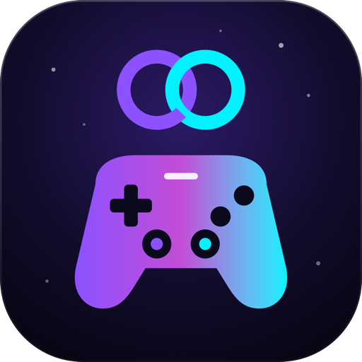

<p align="center">
  
</p>

# PSRemotePlayTogether

**Play one PlayStation together, from anywhere.** One of you connects to their PS5 or PS4 with Remote Play and shares the session. Friends join with an invite, get the same picture and sound, and plug in their own controller. The console sees all of you as a single controller, so any game works, single-player games included.

Free and open source, for Windows, Linux and macOS. Powered by [GamerNova.net](https://gamernova.net/).

## What it does

- **Shared play.** Everybody's controller is merged into the one Remote Play controller. Three ways to share it: everyone at once, one at a time (control passes to whoever is playing while the others rest), or only the host while guests watch.
- **Any controller.** DualSense (with haptics and adaptive triggers when connected by cable), DualShock 4, Xbox and other controllers. Rumble, trigger effects and the light bar reach every player.
- **Voice chat and webcams.** Everybody can talk to and see each other. Mute yourself, mute somebody just for you, switch the webcam on and off during play. The host can mute a guest for everyone or remove them.
- **Controller only.** Sit next to each other, or watch the host's own stream: join without picture and sound and only send your controller.
- **Stream overlay for OBS.** A browser source that shows who is playing, who is in control, every player's controller live, their webcams and who is talking, and plays the conversation so it ends up in your stream. Every player gets the overlay, not only the host.
- **Player profiles.** A name and a picture for each player, shown in the app and in the overlay.
- **Everything Remote Play needs.** Console registration, local and internet Remote Play, HDR, hardware decoding and the rest come from [chiaki-ng](https://github.com/streetpea/chiaki-ng), which this app is built on.

## How it works

```
                 Remote Play                    invite (UDP, encrypted)
  PS5 / PS4  <----------------->   Host   <------------------------------>  Guests
                                  (you)      picture, sound, haptics  -->
                                             <--  controllers
                                             <->  voices and webcams
```

The host runs a normal Remote Play session. What the console sends is passed on to the guests untouched; what the guests press is merged with the host's controller before it goes to the console. Voices and webcams go through the host to everybody else.

Guests need no PlayStation account and no access to the console. The invite contains the host's address and a session key; everything between host and guests is encrypted with it (ChaCha20-Poly1305).

## Getting started

### Share your console

1. Register your console as in any Remote Play app: your PSN account and the PIN from the console's Remote Play settings.
2. Open **Play Together**, switch on **Let friends join my sessions** and choose how the controller is shared.
3. Copy the invite and send it to your friends.
4. Connect to your console. Friends can join as long as you are connected.

Friends in your own network can join right away. For friends elsewhere, forward UDP port **9410** to your computer in your router and put your public address (or a DNS name) into the invite's address field.

### Join a friend

Open **Play Together**, paste the invite and press **Join**. Or from the command line:

```bash
PSRemotePlayTogether --name Alex join "psrpt://host.example.org:9410/…"
```

Add `--controller-only` to join without picture and sound.

### Voice chat and webcam

**Play Together → Voice chat and webcam** has the settings: take part in the voice chat, start muted, which webcam and how large its picture is. Microphone and speakers are the ones from the audio settings. During play, open the stream menu to mute yourself, switch voices or the webcam on and off, and click a player for more.

Use headphones. Without them the others hear themselves through your microphone.

### Stream overlay for OBS

1. **Play Together → Stream overlay for OBS → Turn on the overlay**.
2. Add the address shown there (`http://localhost:9412/` by default) to OBS as a **Browser Source**.
3. For the players' voices to reach your stream, tick **Control audio via OBS** in the Browser Source.

Several sources can show different parts. Add to the address:

| Addition | Shows |
| --- | --- |
| `?show=players` | names, pictures, microphone state |
| `?show=pads` | each player's controller |
| `?show=cams` | the webcams |
| `?show=combined` | the combined controller the game gets |
| `&voice=0` | keeps this source silent |
| `&layout=column`, `&scale=40`, `&skin=PS5 (nova pink)` | arrangement, size, controller look |
| `?demo=1` | made-up players, to set up a scene without a session |

Controller looks: DualSense in white, Midnight Black, Cosmic Red, Nova Pink, Starlight Blue, Galactic Purple, Gray Camouflage, Volcanic Red, Cobalt Blue, Sterling Silver, the three Chroma finishes and the anniversary gray, plus DualShock 4 and Xbox sets. The skins come from [CryptoPad](https://github.com/Crypto90/CryptoPad); the additional DualSense colours are derived from its white one.

## Good to know

- The host's upload carries the game picture to every guest, and every webcam to every other player. Plan with roughly the Remote Play bitrate per guest, plus 0.4 to 2.5 Mbit/s per webcam and receiver depending on the picture size chosen.
- There is no automatic NAT traversal yet: internet play needs the forwarded port.
- Webcams are shown in the stream menu and in the overlay, not yet on top of the game picture.
- All players need the same version of the app.

## Building

macOS (Homebrew):

```bash
scripts/dev-build-macos.sh test
```

That builds the app and runs the tests of the sharing library. The library in `coplay/` has no dependency on the rest of the project and can be built on its own:

```bash
cmake -S coplay -B build-coplay && cmake --build build-coplay && build-coplay/coplay-tests
```

For Linux and Windows see the chiaki-ng build instructions; the dependencies are the same, plus Qt Multimedia for webcam capture (optional).

### Trying it without a console

`coplay-sim` plays a video file as if it were a console and shares it, so that the guest side, the overlay, voices and webcams can be tried on one computer:

```bash
build/coplay/coplay-sim host sample.h264 --voice --cam a.jpg,b.jpg
```

It prints an invite to join with. `coplay-sim` without arguments lists all options.

## Credits and licence

PSRemotePlayTogether is built on [chiaki-ng](https://github.com/streetpea/chiaki-ng) by Street Pea and contributors, which continues [Chiaki](https://git.sr.ht/~thestr4ng3r/chiaki) by Florian Märkl. The controller skins of the overlay are from [CryptoPad](https://github.com/Crypto90/CryptoPad).

Licensed under the [GNU Affero General Public License v3](COPYING) with the OpenSSL exception chiaki uses (see `LICENSES/`). The app is free; whoever passes it on has to offer the source code with it.

This project is not endorsed or certified by Sony Interactive Entertainment. PlayStation, PS5, PS4, DualSense and DualShock are trademarks of Sony Interactive Entertainment.
