<div align="center">

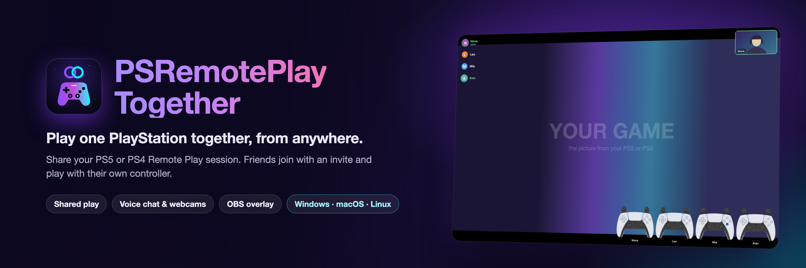

# 🎮 PSRemotePlayTogether

**Play single-player PlayStation games together, from anywhere.**

One PS5 or PS4 · everybody plays as player 1 · voice chat, webcams and a stream overlay for OBS

[](https://github.com/Crypto90/PSRemotePlayTogether/releases/latest)
[](https://github.com/Crypto90/PSRemotePlayTogether/releases)
[](#-download)
[](./COPYING)
[](https://github.com/Crypto90/PSRemotePlayTogether/actions)
[](https://ko-fi.com/crypto90)
[](https://gamernova.net/)

<p align="center">
  <a href="#-download"><b>Download</b></a> •
  <a href="#-what-you-can-do-with-it"><b>What it's for</b></a> •
  <a href="#-everybody-plays-as-player-1"><b>Player 1 for all</b></a> •
  <a href="#-key-features"><b>Features</b></a> •
  <a href="#-quick-start"><b>Quick start</b></a> •
  <a href="#-streaming-with-obs"><b>OBS</b></a> •
  <a href="#-faq"><b>FAQ</b></a>
</p>

</div>

---

## 💡 What is this?

Remember handing the controller to a friend on the couch? **PSRemotePlayTogether does that over the internet**, and without anybody waiting for their turn.

One of you connects to their PS5 or PS4 with Remote Play and shares the session. Friends join with an invite link, in the app or straight in a web browser, see the same picture, hear the same sound and plug in their own controller. The console sees all of you as one controller, so **any single-player game becomes something you play together**: GTA 6, souls-likes such as Elden Ring, story games, open worlds.

It also makes a great stream: the game picture is on your computer, so OBS shows it without a capture card, and the built-in overlay shows every player, webcam and controller live.

<div align="center">
  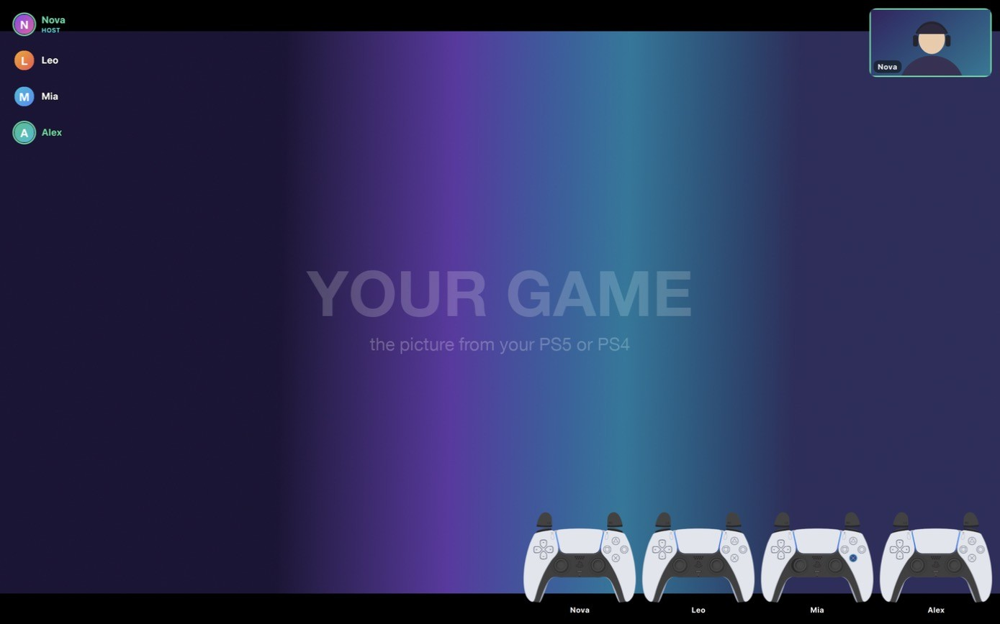
</div>

---

## 🚀 Download

Free, for Windows, macOS and Linux. Everybody who uses the app in a session needs the same version. A friend who only wants to join needs no download at all: the host can send a link that opens in a [web browser](#join-from-a-web-browser-without-the-app).

| System | Download | How to start |
| :--- | :---: | :--- |
| **Windows 10 / 11** (64-bit) | [**⬇️ Windows zip**](https://github.com/Crypto90/PSRemotePlayTogether/releases/latest) | Unzip, run `PSRemotePlayTogether.exe` |
| **macOS 15 or newer** (Apple silicon) | [**⬇️ macOS dmg**](https://github.com/Crypto90/PSRemotePlayTogether/releases/latest) | Open, drag the app to Applications |
| **Linux** (x86_64, arm64) | [**⬇️ AppImage**](https://github.com/Crypto90/PSRemotePlayTogether/releases/latest) | `chmod +x`, then run it |

> 📁 All versions and what changed in each: [GitHub Releases](https://github.com/Crypto90/PSRemotePlayTogether/releases) · [CHANGELOG.md](CHANGELOG.md)

The builds are not signed with a paid developer certificate. On macOS the first start is blocked: open **System Settings → Privacy & Security** and choose **Open Anyway**. On Windows, choose **More info → Run anyway** if SmartScreen asks. The app tells you when a newer version is out.

---

## 🎯 What you can do with it

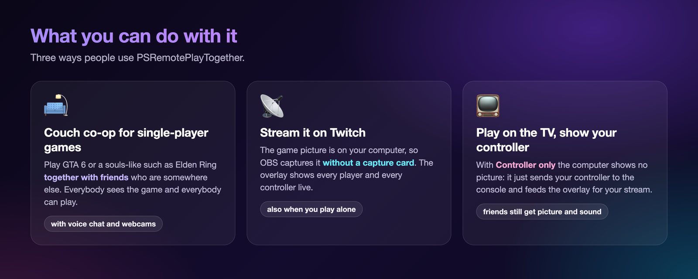

---

## 🕹️ Everybody plays as player 1

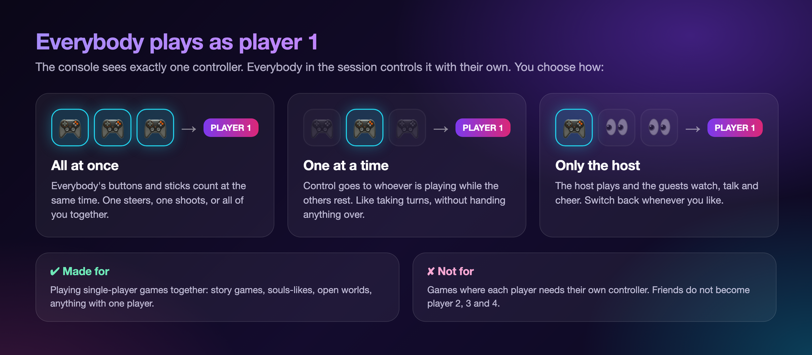

PSRemotePlayTogether does not add players to a game. The console sees exactly **one** controller, and everybody in the session controls it with their own: all at the same time if you like, one at a time, or only the host. Your friends do not become player 2, 3 and 4, so it does not turn a game into a 4-player game. It turns a single-player game into something a group plays.

---

## 🔌 How it works

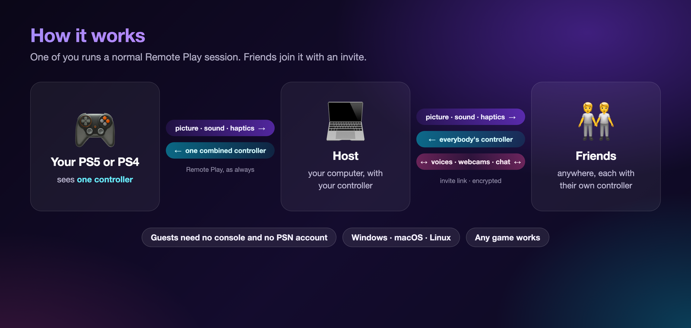

The host runs a normal Remote Play session. What the console sends is passed on to the guests untouched; what the guests press is merged with the host's controller before it goes to the console. Voices and webcams go through the host to everybody else.

Guests need **no PlayStation and no PSN account**. The invite contains the host's address and a session key, and everything between host and guests is encrypted with it (ChaCha20-Poly1305).

---

## ✨ Key features

<table>
  <tr>
    <td width="50%">
      <h3>🤝 Shared play, three ways</h3>
      Everybody's controller is merged into the one Remote Play controller: <b>all at once</b>, <b>one at a time</b>, or <b>only the host</b> while guests watch. The host can switch during the game.
    </td>
    <td width="50%">
      <h3>🎮 Any controller</h3>
      <b>DualSense</b> (with haptics and adaptive triggers by cable), <b>DualShock 4</b>, <b>Xbox</b> and others. Rumble, trigger effects and the light bar reach every player.
    </td>
  </tr>
  <tr>
    <td width="50%">
      <h3>🎙️ Voice chat and webcams</h3>
      Talk to and see each other without another app. Mute yourself, mute somebody just for you, switch the webcam on and off while playing.
    </td>
    <td width="50%">
      <h3>💬 Text chat</h3>
      Clickable links with previews, emoji and shortcodes. New messages show on the game picture and, if you like, in your stream.
    </td>
  </tr>
  <tr>
    <td width="50%">
      <h3>🖼️ Everybody on the game picture</h3>
      Players, who is talking, webcams and every controller live, on top of the game. Drag each piece where you want it and keep arrangements as presets.
    </td>
    <td width="50%">
      <h3>📡 Stream overlay for OBS</h3>
      The same for your viewers as a browser source: players, controllers, webcams, battery and the conversation. Transparent, arranged by dragging. Every player gets one, not only the host.
    </td>
  </tr>
  <tr>
    <td width="50%">
      <h3>📺 Controller only</h3>
      Play on the TV and let the computer only send your controller and feed the overlays. Friends who join still get picture and sound.
    </td>
    <td width="50%">
      <h3>🧩 Everything Remote Play needs</h3>
      Console registration, local and internet Remote Play, HDR and hardware decoding come from <a href="https://github.com/streetpea/chiaki-ng">chiaki-ng</a>, which this app is built on.
    </td>
  </tr>
  <tr>
    <td width="50%">
      <h3>🌐 Join from a web browser</h3>
      A friend without the app opens a link in Chrome, Edge, Firefox or Safari, plugs in a controller and plays along: picture, sound, voice and text chat, webcam, and the same display and stream menu as in the app. Nothing to install.
    </td>
    <td width="50%">
      <h3>🚪 Usually no port to open</h3>
      Host and friends find each other through a small meeting point and then connect directly. Picture, sound and controllers never pass through a server.
    </td>
  </tr>
  <tr>
    <td width="50%">
      <h3>🌍 Public rooms</h3>
      Host privately for your friends, or list your session as a public room with a title, a language and the game that runs. Others search the list by title, game, host or language, in the app or in a browser, see who controls and how many play, and join.
    </td>
    <td width="50%">
      <h3>🚦 You decide who gets in</h3>
      Let each player in yourself, let newcomers watch until you let them play, or open the door to everybody. Close the room to newcomers at any time, and remove a player, for good if you like.
    </td>
  </tr>
</table>

---

## 🏁 Quick start

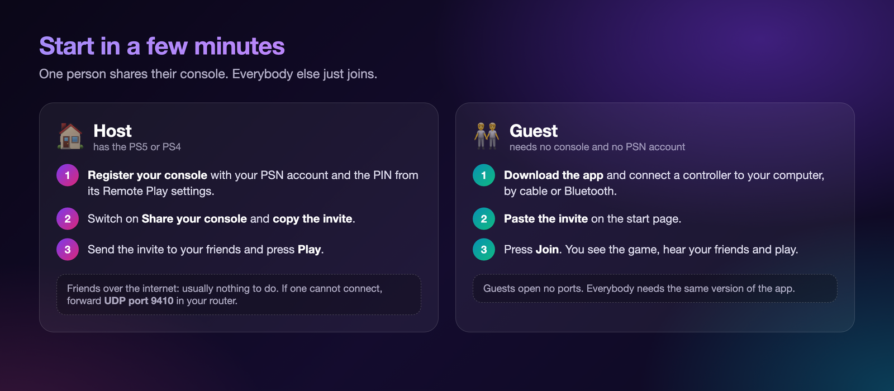

### Host a session

1. Register your console as in any Remote Play app: your PSN account and the PIN from the console's Remote Play settings.
2. Press **Host…** on the start page. Everything about the session is set there, before it starts:
   - **Private**, only friends you send your invite to, or **Public**, listed for everybody (see [Public rooms](#public-rooms)). A public room also gets a title, a language, and who gets in: you let each player in, everybody but watching until you let them play, or everybody playing at once.
   - How many friends, and who controls: all at once, one at a time, or only you while the others watch.
   - Whether friends without the app may join from a web browser, and whether guests may send the console to sleep when they leave.
   - **I play on the TV** if you watch the console on the TV and the computer should only send your controller and feed the overlays. Friends still get picture and sound.
3. Copy an invite on the same page and send it: for a friend over the internet, in the same network, over IPv6, or a link for a web browser. A public room has an invite of its own there, to send friends straight to it.
4. Press **Start** (**Wake up & start** while the console sleeps). Friends can join as long as you are connected.

**Play** on the console itself is for playing on your own: nobody can join that session. The app remembers which of the two you chose last, for when it connects at start.

When a guest leaves, the console stays as it is: only you send it to sleep, unless you switched on **Guests may put the console to sleep when they leave**, for example for a friend who plays on while you are away.

<div align="center">
  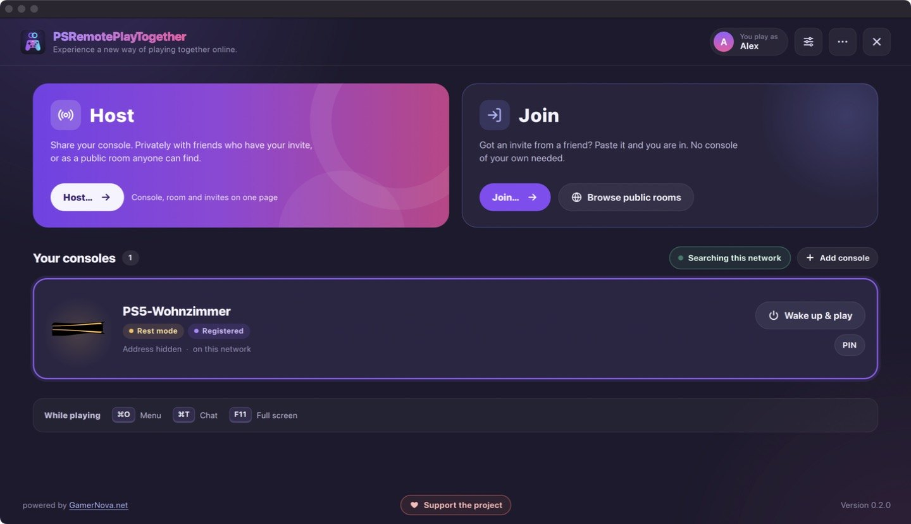
</div>

### Does the host have to open a port?

Usually not.

| Your friends are… | What the host does |
| :--- | :--- |
| in the same network or the same VPN | Nothing. Send the **Same network** invite. |
| somewhere on the internet | With most routers: nothing. Send the **Internet** invite. The two apps find each other through a small **meeting point** on the internet and then connect directly. |
| somewhere on the internet, and it does not connect | Forward **UDP port 9410** to your computer in your router. That always works, and it is used by itself as soon as it is there. The port can be changed under Play Together. |
| in a web browser, and it does not connect | Forward **UDP port 9411** as well: browsers come in on a port of their own, one above the sharing port. |

Guests never open a port.

**How joining without a port works.** Host and guest each leave a short sealed note with their own addresses at the meeting point, read each other's, and send to each other at the same moment. That makes both routers let the other side in ("UDP hole punching"). The meeting point only passes these notes on: picture, sound and controllers go directly between the players, never through a server.

It works with ordinary home routers and over IPv6. It does not get through when a router gives every connection a new port ("symmetric NAT", common in mobile networks and with some fibre providers) and the router on the other side is strict as well. While you share, the stream menu says which case you are in. The details are in [docs/nat-traversal.md](docs/nat-traversal.md).

For this the app asks a STUN server for your address on the internet (Google's by default) and uses the meeting point at gamernova.net. Both can be changed or switched off under **Play Together**, and the meeting point is one small PHP file that you can host yourself: [server/meeting-point](server/meeting-point).

> 💡 **Still no way through?** Put everybody into one virtual network with a mesh VPN such as Tailscale or ZeroTier, enter your VPN address under **Play Together → Own internet address** and send that invite.

### Join a friend

Press **Join…** on the start page, paste the invite and press **Join**. Tick **With my controller only** if you sit in front of the same TV and need no picture or sound. If the host lets each player in, you see "Waiting for the host to let you in…" until they do. Or from the command line:

```bash
PSRemotePlayTogether --name Alex join "psrpt://host.example.org:9410/…"
```

`PSRemotePlayTogether` is the program in the download: `PSRemotePlayTogether.exe` in the Windows zip, the `.AppImage` file itself on Linux, and `PSRemotePlayTogether.app/Contents/MacOS/PSRemotePlayTogether` on macOS. Add `--controller-only` to join without picture and sound.

### Join from a web browser, without the app

A friend who does not want to install anything can play from a browser.

1. Host: copy the **Web browser** invite (on the **Host…** page, and during a game in the stream menu → **Copy invite**). It is a link.
2. Friend: open the link in a current **Chrome, Edge, Firefox or Safari**, enter a name, press a button on the controller so that the browser sees it, and press **Join**.

The browser gets the same picture and sound and its controller plays along like everybody else's. Voice chat, text chat, webcams (the friend's own too), a player picture and rumble work as well. Without a controller the keyboard can stand in, and a phone or tablet gets controls on the screen.

On the game picture it looks and works like the app: the same display of players, webcams and controllers with the same presets and the same way of arranging them, the same stream menu, chat and options. The stream menu opens with **Ctrl+O** (**⌘O** on a Mac), with **L1+R1+L3+R3** on the controller, or with the **Menu** button that shows when the mouse moves.

The connection goes straight from the browser to the host's computer (WebRTC), set up through the same meeting point the app uses; nothing of the session passes through a server. The key of the session stands behind the `#` of the link, which a browser never sends anywhere, and the page takes it out of the address bar as soon as it is opened.

Where a browser falls short: the game's haptics arrive as plain rumble, and it adds a little delay compared to the app. The touchpad, the motion sensors, adaptive triggers and the light bar need a DualSense that the browser opens directly (Chrome and Edge only, **DualSense…** in the stream menu; this part is new and little tested). A PS5 streams H.265 by default, which Chrome, Edge and Safari play on most computers; if a friend's browser cannot, the host can switch to H.264 under **Settings → Video**. Like the app without a forwarded port, it does not get through every pair of routers (see above). A browser cannot use the sharing port; if a friend's browser cannot connect, the host forwards a second one for browsers, **UDP port 9411** (one above the sharing port, to be changed under Play Together).

It can be switched off on the **Host…** page (**Friends without the app can join from a web browser**), and the page is a folder of static files (`web/`) that you can host yourself. More in [docs/web-guests.md](docs/web-guests.md).

### Public rooms

A session can be found by people you have never sent an invite to. Choose **Public** on the **Host…** page and give the room a title and a language; the game that runs on the console is shown by itself.

- **Finding one:** **Join… → Public rooms** in the app, or the page for web browsers without an invite. Search by title, game, host or language, pick a language, and hide full rooms or rooms where the host lets each player in; the app also sorts them by players, free places or age. Every room shows the game, how many play, who controls (everybody at once, one at a time, or only the host), and whether browsers are welcome.
- **Getting in** works like with an invite: straight to the host, nothing passes through the list. If the host lets each player in, you wait at the door until they do.
- **As the host** you see who knocks, as a note on the game picture and in the stream menu, and press **Let in** or **No**. In the stream menu the room can be **Closed to newcomers** (it leaves the list; players who were in before can come back), and a click on a player removes them, with **Remove and block** for the rest of the session.
- **What the list shows about you:** the room's title and language, the game, your name in the app, the number of players, and an invite: the room has a key of its own, new for every public session, and your private invites stay private. The invite names no address, but players connect to your computer directly, as with every invite, and so learn its internet address. In a public room that can be anybody who reads the list.

The list is one small PHP file next to the meeting point, which you can host yourself: [server/rooms](server/rooms). **Play Together → Network → Public rooms** takes the address of your own, and **off** switches public rooms off.

### Your controller

Connect your controller **to your computer**, by Bluetooth or cable, not to the console. The app reads it there and passes it on. A controller that is paired with the console directly is invisible to the app and to the overlays.

### While you play: the stream menu

Press **Ctrl+O** (**⌘O** on macOS), or hold **L1 + R1 + L3 + R3** on the controller, to open the stream menu on top of the game. It has the players, your microphone, the others' voices and your webcam, who may control, the invite, and the overlays. The host can click a player to mute them for everybody, let them only watch, or remove them (with **Remove and block**, for the rest of the session), answer who wants to join, and close the session to newcomers.

<div align="center">
  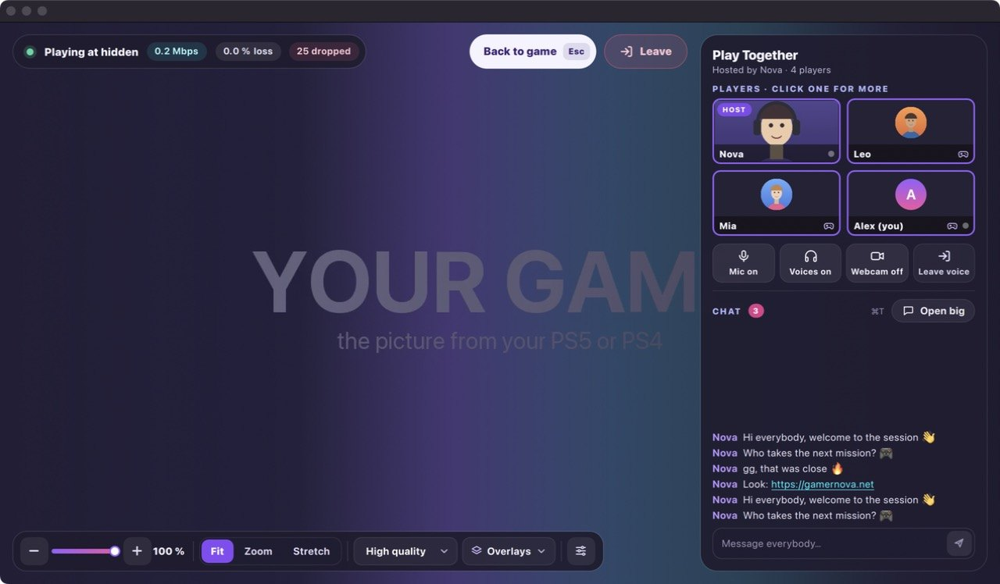
</div>

---

## 🎥 Streaming with OBS

You do not need friends in the session to use this for your stream.

- **No capture card needed.** The game picture arrives on your computer through Remote Play, so OBS can capture the app's window directly, in Remote Play quality (up to 1080p).
- **Controller visualization.** The overlay shows your controller live: buttons, sticks and triggers. With friends in the session it shows everybody's.
- **Or play on the TV.** With **I play on the TV** (controller only) the computer shows no picture and only sends your controller to the console and feeds the overlay. The picture for your stream then comes from your own capture, for example a capture card.

**Setting up the overlay**

1. **Play Together → Overlays → OBS overlay → Overlay on**.
2. Add the address shown there (`http://localhost:9412/` by default) to OBS as a **Browser Source**.
3. For the players' voices to reach your stream, tick **Control audio via OBS** in the Browser Source.

<div align="center">
  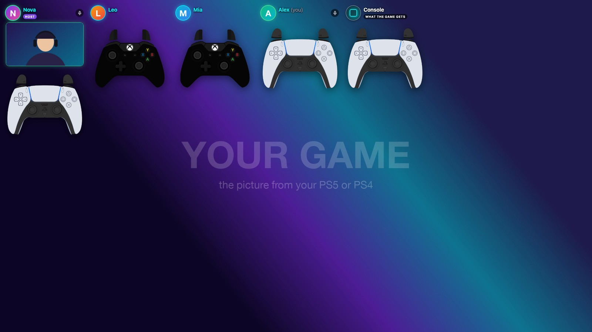
</div>

What the overlay shows, how it looks and where everything sits is set in the app, also from the stream menu during play, and OBS follows at once. To place things yourself, switch on **Place every player and the console's controller freely** and press **Arrange in the browser**.

<details>
<summary><b>Several sources showing different parts</b></summary>

Add to the overlay address:

| Addition | Shows |
| --- | --- |
| `?show=players` | names, pictures, microphone state |
| `?show=pads` | each player's controller |
| `?show=cams` | the webcams |
| `?show=combined` | the combined controller the game gets |
| `&voice=0` | keeps this source silent |
| `&style=glass`, `&style=solid` | boxes around the players instead of the transparent look |
| `&battery=0` | hides the controller battery |
| `&chat=0` | hides the chat |
| `&layout=column`, `&scale=40`, `&skin=PS5 (nova pink)` | arrangement, size, controller look |
| `?demo=1` | made-up players, to set up a scene without a session |

Controller looks: DualSense in white, Midnight Black, Cosmic Red, Nova Pink, Starlight Blue, Galactic Purple, Gray Camouflage, Volcanic Red, Cobalt Blue, Sterling Silver, the three Chroma finishes and the anniversary gray, plus DualShock 4 and Xbox sets. The skins come from [CryptoPad](https://github.com/Crypto90/CryptoPad); the additional DualSense colours are derived from its white one.

</details>

---

## 🖼️ On the game picture

**Play Together → Overlays → On the game picture**, or **Options…** under Overlays in the stream menu, decides what lies on top of the game for you while playing: the players with picture, name and a ring that lights up when they talk, the webcams, everybody's controller, the controller the console gets, and short notes when somebody joins or writes.

Choose **Arrange** in the stream menu to drag the pieces into place; the mouse wheel or the + and − buttons change a piece's size.

<table>
  <tr>
    <td width="50%">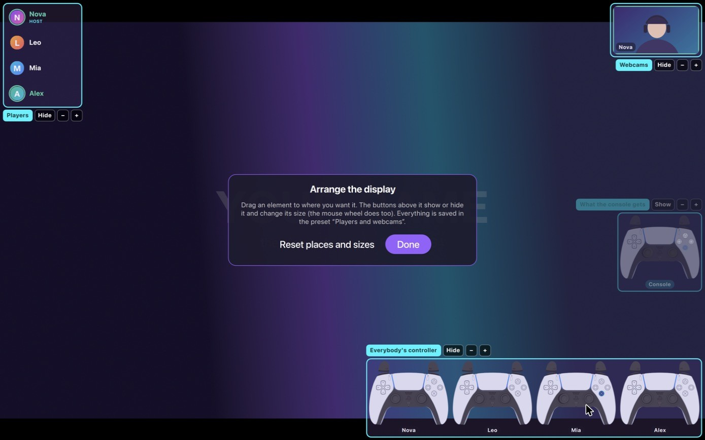</td>
    <td width="50%">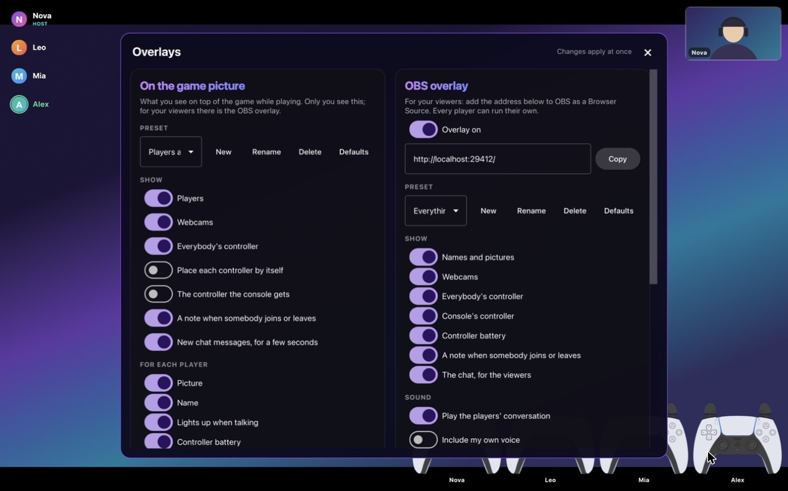</td>
  </tr>
</table>

Three looks: transparent without boxes (the default), glass boxes, dark boxes. A set of choices is a **preset**: make as many as you like, for example one for playing and one for watching, and switch between them at any time.

<details>
<summary><b>Voice chat, webcam and text chat in detail</b></summary>

**Voice chat and webcam.** **Play Together → Voice & webcam** has the settings: take part in the voice chat, start muted, which webcam and how large its picture is. Microphone and speakers are the ones from the audio settings. You never hear your own voice in the app, only the others. Use headphones: without them the others hear themselves through your microphone.

**Text chat.** Press **Ctrl+T** (**⌘T** on macOS), or choose **Chat** in the stream menu. The chat opens beside the game and takes the keyboard while it is open; Escape gives it back to the game. Anybody who joins later sees the last 30 messages.

- Links can be clicked. For the first link in your own message, your app looks at the page once and sends a small preview along, so your friends' apps never contact a site they did not choose. This can be switched off under **Play Together → Voice & webcam**.
- Emoji come from the picker, from shortcodes such as `:fire:`, `:gg:`, `:thumbsup:`, and from `:)`, `:D`, `<3`, `xD`.
- New messages show on the game picture for a few seconds and, if you want, in the OBS overlay.

</details>

---

## ❓ FAQ

**Can we play 4-player games with this?**
No. The console sees one controller, and all of you are that one player. It is made for playing single-player games together.

**Do my friends need a PlayStation or a PSN account?**
No. Only the host needs the console and the account. Guests need the invite and a controller, and either the app or just a web browser.

**Can a friend join without installing anything?**
Yes: send them the **Web browser** invite, a link that opens in Chrome, Edge, Firefox or Safari. See [Join from a web browser](#join-from-a-web-browser-without-the-app).

**Which games work?**
Every game that works with Remote Play. A few games block single scenes for Remote Play; the app says so when that happens.

**Is my controller connected to the console or to the computer?**
To the computer, by Bluetooth or cable. That holds for the host and for every guest.

**Do I need a capture card to stream?**
No. The game picture is in the app's window, which OBS can capture. Only if you play on the TV with **Controller only** does the picture come from somewhere else.

**How much upload does the host need?**
Roughly the Remote Play bitrate per guest, plus 0.4 to 2.5 Mbit/s per webcam and receiver, depending on the picture size chosen.

**Do I have to forward a port in my router?**
Usually not: with most routers friends get in by themselves, through the meeting point. If a friend cannot connect, forwarding UDP port 9410 always works. See [Does the host have to open a port?](#does-the-host-have-to-open-a-port)

**What does the meeting point learn about us?**
The IP addresses of the computers that ask it, like any web server. It cannot read the notes the apps leave there, never sees the session's key, and no picture, sound or controller data passes through it. **Play Together → Meeting point → off** switches it off; then the forwarded port is the only way in.

**Is the invite safe to share?**
It is the key to your session, so give it only to the people who should join. Everything between host and guests is encrypted with it, and **Make a new invite** under Play Together makes old ones stop working.

**Can strangers get into my session?**
Only into a public room, and only as you set it up: with **I let each player in**, nobody sees or plays anything before you let them in. Your private invites never appear on the list; a public room has a key of its own, which is new for every public session. **Closed to newcomers** in the stream menu takes the room off the list.

**Nothing shows on the game picture on Windows or Linux?**
The display on the game picture needs the Vulkan renderer there, which is the default: **Settings → Video → Renderer**.

**How do I get updates?**
The app asks GitHub at start whether a newer version exists and tells you. It never downloads anything by itself, and the check can be switched off under **Settings → General**.

---

## 🛠️ Building from source

macOS (Homebrew):

```bash
scripts/dev-build-macos.sh test
```

That builds the app and runs the tests of the sharing library. The library in `coplay/` has no dependency on the rest of the project and can be built on its own:

```bash
cmake -S coplay -B build-coplay && cmake --build build-coplay && build-coplay/coplay-tests
```

For Linux and Windows see the chiaki-ng build instructions; the dependencies are the same, plus Qt Multimedia for webcam capture (optional).

The downloads are built by GitHub Actions ([`.github/workflows/build.yml`](.github/workflows/build.yml)). [docs/releasing.md](docs/releasing.md) describes the pipeline, how to publish a release, and how to run the same builds on your own machine.

<details>
<summary><b>Trying it without a console</b></summary>

`coplay-sim` plays a video file as if it were a console and shares it, so that the guest side, the overlay, voices and webcams can be tried on one computer:

```bash
build/coplay/coplay-sim host sample.h264 --voice --cam a.jpg,b.jpg
```

It prints an invite to join with. With `--meet` and `--web` it also takes guests from a web browser and prints the link for them; [docs/web-guests.md](docs/web-guests.md) has the two commands for trying that on one machine. `coplay-sim` without arguments lists all options. `coplay-sim stun` asks the same servers the app asks for the invite for friends elsewhere, and prints the address this computer has on the internet.

</details>

---

## ☕ Support the Developer

If PSRemotePlayTogether gives you and your friends a good evening, or makes your stream more fun, please consider buying me a coffee:

<div align="center">

[](https://ko-fi.com/crypto90)

</div>

---

## 📄 Credits and licence

PSRemotePlayTogether is built on [chiaki-ng](https://github.com/streetpea/chiaki-ng) by Street Pea and contributors, which continues [Chiaki](https://git.sr.ht/~thestr4ng3r/chiaki) by Florian Märkl. The controller skins of the overlay are from [CryptoPad](https://github.com/Crypto90/CryptoPad). Guests in a web browser reach the host through [libdatachannel](https://github.com/paullouisageneau/libdatachannel) by Paul-Louis Ageneau (MPL 2.0), with libjuice and usrsctp.

Licensed under the [GNU Affero General Public License v3](COPYING) with the OpenSSL exception chiaki uses (see `LICENSES/`). The app is free, and so is its source code: it is all in this repository.

This project is not endorsed or certified by Sony Interactive Entertainment. PlayStation, PS5, PS4, DualSense and DualShock are trademarks of Sony Interactive Entertainment. Game titles are named as examples only and belong to their owners.

<div align="center">

**Powered by [GamerNova.net](https://gamernova.net/)**

</div>
